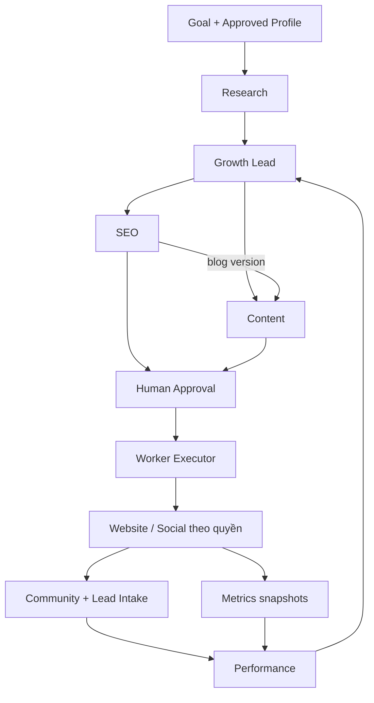

# Cấu trúc 6 agent — baseline 14/10/2026

## Quyết định và trạng thái

Giữ monorepo hiện tại, một AI service Python, một worker TypeScript và PostgreSQL dùng chung theo workspace. Không tạo sáu microservice hay sáu database. AI có thể chạy một job tại một thời điểm. Human approval Level 2 và ads read-only theo tài liệu Word.

Đã thực hiện trong lần tái cấu trúc: tách handler generic sang `services/ai/src/app/bootstrap.py`; giữ import tương thích ở operations.py; thêm `agents/registry.py` làm bản đồ 6 role→operation; tạo 6 khu vực triển khai agent và hướng dẫn ownership; thay baseline điều phối sang 7 người/15 ngày. HTTP schemas và tên operation hiện có được giữ.

**Cập nhật QQ-01–03:** Research đã có pipeline/schema/prompt riêng, shared snapshot scope checks và AI run artifact; live HTTP/retry/restart có evidence trong handoff. **Còn triển khai:** năm pipeline Marketing khác, workflow DAG durable, HTTP worker adapter trong worker chính, tool enforcement và publish/lead/metrics production. Registry chỉ là metadata, không cấp quyền và không chứng minh agent hoàn thành. Các phần này có owner/task trong sprint. Handler generic vẫn phục vụ các operation chưa chuyển đổi; research.run đã chuyển typed contract theo CR-002, chờ reviewer nghiệm thu.

## Cấu trúc thực thi

```text
apps/
  api/src/modules/              Thiệu Quang: core, ledger, approval, lead persistence
                                Mỹ: publishing/intake/metrics/integration slices
  worker/src/
    jobs/                       Mỹ: runner/retry/lease, phát triển workflow dependency
    adapters/                   Mỹ: AI HTTP, CMS, analytics, storage/queue
  web/src/                      Tiến: dashboard/editor/approval/lead/report
  pilot/                        Tiến: website/blog/form công khai
services/ai/
  src/app/operations.py         Registry handler/schema/prompt
  src/app/bootstrap.py          Generic fallback hiện có, chờ thay từng operation
  src/agents/registry.py        Sáu role và operation tương ứng
  src/agents/research/          QQ: Research & Trend
  src/agents/growth_lead/       QQ: Growth Lead & Analyst
  src/agents/seo/               QQ: SEO Worker
  src/agents/content/           QQ: Content Marketing
  src/agents/community/         QQ: Community & Lead Intake
  src/agents/performance/       QQ: Performance Marketing
  src/agents/growth_map.py      Handler đã có, tiếp tục dùng qua operation cũ
  src/rag/                     Shared ingest/retrieval/answer đã có
  src/guardrails/              Shared fact validation đã có
  prompts/                     Prompt có version; giữ prompt RAG/growth-map hiện tại
  evals/                       Shared dataset/rubric + eval riêng role trong sprint
contracts/                     HTTP/JSON boundary, TQ quản; AI/FE/QA review
database/                     Dùng migrations/seed/policies hiện tại
design/                       Trường: common components và spec theo flow
qa/                           Thiệu: hai lane, fixtures, evidence
docs/coordination/
   sprint-3-weeks/              Baseline hiện hành + bảy TODO cá nhân
   sprint-3-weeks/CLEANUP.md    Biên bản loại checklist cũ và thành phần giữ lại
```

Research đã có pipeline.py/schemas.py; năm thư mục còn lại chứa hướng dẫn triển khai, chưa có handler chuyên trách. Khi triển khai, thêm `pipeline.py` + `schemas.py` tại role tương ứng và đăng ký handler ở operations.py. Không import TypeScript source từ Python. Không di chuyển RAG/growth_map hiện có chỉ để đổi tên thư mục.

## Luồng và dữ liệu



Orchestrator bằng code điều khiển task dependencies. Growth Lead chỉ đề xuất plan/next tasks; backend validate role/tool/budget/dependency trước enqueue. Các task có input refs và output artifact refs, không truyền toàn bộ lịch sử chat.

TQ-02 mở rộng schema hiện có: workflow/run/task/dependency, content version, approval, publication; reuse campaign/content/assets/agent_runs/agent_tasks/audit/idempotency. TQ-05 thêm lead DB và TQ-07 metrics/report refs theo contract tối thiểu. Không mặc định content_variant là immutable edit version: variant là dẫn xuất theo kênh; version là bản chỉnh sửa của cùng nội dung.

Context gồm workspace_id, campaign_id, task/run ID, profile/source versions và input artifact/version/hash. Thay facts/nguồn hoặc sửa bài làm output liên quan stale và approval mất hiệu lực. Executor recheck tại thời điểm publish/send.

Workflow dự kiến: queued → running → awaiting_approval/blocked → completed; failed/retrying/cancelled là nhánh ngoại lệ. Job technical state hiện có vẫn giữ cho từng lần thực thi. Human wait là workflow state, không giữ lease/LLM chạy. Outbox transaction + dedup key nối thay đổi state và enqueue; restart chỉ retry step cần thiết.

## Ranh giới công cụ

Research: web/read knowledge; Growth Lead: campaign/task proposal và aggregate metrics; SEO/Content: draft/asset; Community: grounded draft + lead intake; Performance: read snapshots và proposal. Publish/send đi qua executor sau approval. Credential server-side, workspace/account/tool allowlist và audit do gateway thực thi, không dựa vào prompt.

Operation `content.generate` tiếp tục thuộc Content để tương thích; blog SEO mới đi qua `seo.local_draft`. `analytics.report` thuộc Performance, Growth Lead nhận report artifact để tổng hợp learning. `knowledge.ingest`, `knowledge.answer`, `growth_map.suggest`, `health.check` là shared operations, không tăng số agent sản phẩm.

## Lộ trình chuyển đổi

1. Tách bootstrap và nhóm operation (đã thực hiện); giữ baseline test service/RAG.
2. MY-01/TQ-02: HTTP adapter, persistence và typed routing; không đưa publish/metrics/lead qua LLM generic.
3. QQ-03–06: thêm pipeline + schema + prompts + role eval, thay handler từng operation.
4. MY-03/TQ-03: dependencies, snapshots, outbox, human wait/recovery.
5. TQ-04/MY-04–06/TI-04–07: duyệt/publish/lead/metrics/UI.
6. QQ-07/TH-07–09: đóng vòng, failure tests, evidence và release decision.

[Bản đồ tái sử dụng](../coordination/sprint-3-weeks/REUSE-MAP.md) · [TODO tổng](../../TODO.md).

[Handoff QQ-01–03](../coordination/sprint-3-weeks/QQ01-03-HANDOFF.md) ghi rõ phạm vi AI boundary và các dependency BE còn lại.
