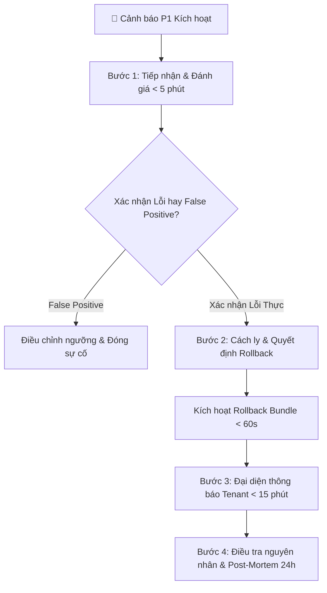

# RUNBOOK XỬ LÝ SỰ CỐ AGENT CONTENT MARKETING (INCIDENT RUNBOOK)

> **Mã tài liệu:** `DOC-CM-RUNBOOK-v2.0`  
> **Áp dụng cho:** Agent Số 4 — Content Marketing (AI Growth OS)  
> **Mục tiêu:** Quy định trách nhiệm, quy trình phản ứng khẩn cấp, thao tác Rollback <60s và cơ chế thông báo khách hàng (Tenant).

---

## 1. Phân Cấp Mức Độ Sự Cố (Severity Matrix)

| Mức độ | Định nghĩa sự cố | Ví dụ cụ thể | SLA phản hồi | SLA xử lý / Mitigate |
| :---: | :--- | :--- | :---: | :---: |
| **🚨 P1 (Critical)** | Sự cố nghiêm trọng đe dọa trực tiếp đến tính chân thật của thông tin, uy tín pháp lý thương hiệu, hoặc tỷ lệ từ chối hệ thống tăng đột biến. | - Tỷ lệ từ chối >15% trên cửa sổ 50 bài liên tiếp.<br>- **3 bài viết liên tiếp vi phạm tính chân thật** (giá ảo, ưu đãi giả, % bịa đặt).<br>- Có >= 2 bài vi phạm sự thật trong 24h (khi lưu lượng bài ít). | **<= 15 phút** | **<= 30 phút** (Rollback < 60s) |
| **⚠️ P2 (Major)** | Suy giảm chất lượng hoặc hiệu năng nhưng chưa gây rò rỉ thông tin sai lệch ra kênh công khai. | - Số vòng tự sửa phản tư trung bình > 1.2 vòng.<br>- Điểm đánh giá LLM Judge < 90/100.<br>- Tỷ lệ lỗi API cục bộ một kênh (FB/TikTok) > 10%. | <= 1 giờ | <= 4 giờ |
| **ℹ️ P3 (Minor)** | Sự cố nhỏ, cảnh báo hiệu năng hoặc trượt SLA độ trễ nhưng quy trình sản xuất vẫn hoàn thành an toàn. | - Độ trễ P95 vượt ngưỡng 30 giây.<br>- Lỗi OCR font chữ trên ảnh AI (tự retry thành công). | <= 4 giờ | <= 24 giờ |

---

## 2. Ma Trận Trách Nhiệm Sự Cố (RACI Matrix)

Khi có cảnh báo sự cố phát sinh, việc phối hợp tuân thủ nghiêm ngặt bảng phân quyền sau:

| Vai trò trong sự cố | Chức danh phụ trách | Trách nhiệm chính (RACI) | Quyền hạn quyết định |
| :--- | :--- | :--- | :--- |
| **Chỉ Huy Sự Cố (Incident Commander - IC)** | **Tech Lead / AI Architect** | **Accountable (A)** | Toàn quyền quyết định kích hoạt **Rollback Bundle**, tạm dừng luồng xuất bản (Halt Publishing), hoặc cho phép khôi phục hoạt động. |
| **Kỹ Sư Ứng Cứu (On-call Engineer)** | **MLOps / DevOps / AI Engineer** | **Responsible (R)** | Tiếp nhận cảnh báo, phân tích log, thực thi lệnh rollback qua CLI, kiểm tra trạng thái dịch vụ và báo cáo cho IC. |
| **Đại Diện Giao Tiếp Khách Hàng (Tenant Liaison)** | **Customer Success Lead / Account Manager** | **Responsible (R)** | Soạn thảo và gửi thông báo chính thức cho đầu mối Tenant bị ảnh hưởng; tiếp nhận phản hồi từ khách hàng. |
| **Trưởng Bộ Phận Nội Dung (Content Lead)** | **Content Specialist Lead** | **Consulted (C)** | Thẩm định các mẫu nội dung có nghi vấn, rà soát prompt bundle và Golden Set để tìm nguyên nhân sai lệch. |
| **Quản Lý Dự Án (Project Manager)** | **Project Manager** | **Informed (I)** | Theo dõi tiến độ xử lý, ghi nhận báo cáo Post-Mortem và điều phối lịch họp rút kinh nghiệm. |

---

## 3. Quy Trình 4 Bước Phản Ứng Khẩn Cấp Sự Cố P1



### Bước 1: Tiếp nhận và Đánh giá Sơ bộ (Thời gian: <= 5 phút)
1. Kỹ sư trực On-call nhận thông báo qua Slack/Telegram/PagerDuty từ Prometheus Alertmanager:
   - Rule `ContentHighRejectionRateRolling50` hoặc
   - Rule `ContentConsecutiveFactualViolations` hoặc
   - Rule `ContentLowVolumeDailyFactualViolations`.
2. Mở Grafana Dashboard: `AI Growth OS — Agent Content Marketing: Giám Sát Cửa Sổ Trượt 50 Bài & SLA` tại UID `content-marketing-rolling-50`.
3. Kiểm tra ngay 3 chỉ số then chốt:
   - Tỷ lệ từ chối hiện thời trên cửa sổ 50 bài.
   - Số bài vi phạm sự thật liên tiếp.
   - Mã lỗi và log chi tiết tại `/internal/v1/content/metrics`.

### Bước 2: Quyết định và Thực thi Rollback Khẩn Cấp (Thời gian: <= 60 giây)
- **Người ra quyết định:** **Tech Lead / Incident Commander**.
- **Điều kiện kích hoạt Rollback ngay lập tức:**
  - Phát hiện 3 bài liên tiếp vi phạm sự thật (Factual Violation) **HOẶC**
  - Tỷ lệ từ chối > 15% do lỗi nội dung/prompt sau một đợt cập nhật bundle mới **HOẶC**
  - Phát hiện Model Drift nghiêm trọng từ phía nhà cung cấp LLM.

- **Thao tác Rollback qua CLI (Không cần redeploy mã nguồn, không restart container):**
```bash
# Đứng tại thư mục gốc của dự án:
python scripts/rollback_bundle.py --reason "P1 Incident: 3 consecutive factual violations detected"
```

- **Kết quả kỳ vọng trên màn hình (Thực thi trong < 1 giây):**
```text
============================================================
  AI GROWTH OS — BUNDLE ROLLBACK CONTROLLER
============================================================
Previous Active Bundle: content_agent_release_v2
New Active Bundle:      content_agent_release_v1
Reason:                 P1 Incident: 3 consecutive factual violations detected
Actual Elapsed Time:    0.000814 seconds (0.81 ms)
SLA Check (< 60.0s):    PASS (COMPLIANT)
============================================================
```

- **Xác thực sau Rollback:**
  - Gọi endpoint `GET /metrics` hoặc `GET /internal/v1/content/metrics` để xác nhận `content_active_bundle_info` đã chuyển về bundle an toàn trước đó.
  - Các bài viết mới được đưa vào xử lý sẽ lập tức sử dụng bộ prompt & rules của bundle cũ.

### Bước 3: Thông Báo Cho Khách Hàng / Tenant (Thời gian: <= 15 phút)
- **Người thực hiện:** **Customer Success Lead / Account Manager**.
- **Người phê duyệt nội dung thông báo:** **Tech Lead / Incident Commander**.
- Tuyệt đối không để khách hàng tự phát hiện lỗi trước khi có thông báo từ hệ thống.
- Gửi thông báo qua kênh phối hợp chính thức (Email / Nhóm chat Zalo/Slack doanh nghiệp).

---

## 4. Mẫu Văn Bản Thông Báo Sự Cố Cho Tenant (Customer Notification Template)

### Mẫu 1: Thông báo Sự cố P1 và Kích hoạt Rollback Tự động
```text
Kính gửi: Ban Điều Hành & Đội Ngũ Vận Hành [Tên Khách Hàng - Ví dụ: TripC Da Nang],

Hệ thống giám sát chất lượng AI Growth OS vừa phát hiện sự bất thường trong quá trình sinh nội dung mạng xã hội của workspace [workspace_id]:

- Mã sự cố: INC-20261027-01 (Mức độ P1 - Nghiêm trọng)
- Thời điểm phát hiện: 09:30 AM ngày 27/10/2026.
- Hiện tượng: Hệ thống phát hiện vi phạm rào chắn tính chân thật trên 3 bản nháp liên tiếp (nội dung câu không khớp 100% với sự thật bóc tách từ bài viết nguồn).
- Hành động xử lý tức thời:
  1. Toàn bộ hàng đợi duyệt bài và xuất bản của các nội dung nghi vấn đã được tự động TẠM DỪNG, KHÔNG có bất kỳ bài viết sai lệch nào bị xuất bản lên Fanpage hay TikTok của Quý khách.
  2. Đội ngũ kỹ thuật đã kích hoạt quy trình Rollback về phiên bản Bundle ổn định trước đó (thời gian hoàn tất: 0.81 mili-giây).
  3. Hệ thống sinh nội dung đã trở lại trạng thái an toàn bình thường.

Đội ngũ kỹ thuật của chúng tôi đang tiến hành điều tra nguyên nhân gốc rễ và sẽ gửi Báo cáo Phân tích Sự cố (Post-Mortem) chi tiết tới Quý đối tác trước 17:00 chiều nay.

Xin chân thành cáo lỗi vì sự bất tiện này.
Trân trọng,
[Họ và tên] - Customer Success Lead, AI Growth OS
Hotline hỗ trợ kỹ thuật: 090x.xxx.xxx
```

### Mẫu 2: Thông báo Kết luận & Khôi phục Hoạt động Bình thường
```text
Kính gửi: Quý Đối Tác [Tên Khách Hàng],

Liên quan đến sự cố INC-20261027-01 được thông báo sáng nay:
- Đội ngũ kỹ thuật đã hoàn tất rà soát nguyên nhân: Do nhà cung cấp LLM có sự thay đổi nhẹ trong cách trả về định dạng dấu câu, dẫn đến bộ bóc tách câu kích hoạt chế độ phòng vệ nghiêm ngặt.
- Chúng tôi đã cập nhật bộ kiểm tra quy tắc và hiệu chuẩn lại mà không ảnh hưởng tới dữ liệu của Quý khách.
- Trạng thái hệ thống: Đã kiểm tra 15 ca đối kháng kiểm thử, đạt 100% tiêu chuẩn an toàn. Luồng phê duyệt bài viết đã được mở lại bình thường.

Cảm ơn Quý đối tác đã luôn đồng hành và phối hợp chặt chẽ.
Trân trọng.
```

---

## 5. Hướng Dẫn Chi Tiết Các Kịch Bản Sự Cố Thường Gặp

### 5.1. Kịch bản P1-A: Tỷ Lệ Từ Chối > 15% Trong Cửa Sổ 50 Bài (`ContentHighRejectionRateRolling50`)
- **Triệu chứng:** Panel *Tỷ Lệ Từ Chối (Rolling 50 Posts)* chuyển sang màu đỏ, giá trị > 0.15.
- **Nguyên nhân tiềm tàng:**
  1. Kho ảnh thực tế thiếu ảnh approved cho các bài mô tả phòng/nội thất (bị `DualAssetManager` chuyển sang `needs_assets`).
  2. Nguồn bài SEO đầu vào bị thiếu facts cốt lõi (dưới 3 facts) dẫn đến `insufficient_data`.
  3. Prompt mới quá khắt khe hoặc có thay đổi logic khiến Reflection loop thất bại.
- **Biện pháp xử lý:**
  1. Kiểm tra tỷ lệ lỗi phân bổ: Do `needs_assets` hay `insufficient_data`?
  2. Nếu do thiếu ảnh thật: Thông báo Content Specialist và Tenant bổ sung tài nguyên ảnh chụp thực tế vào kho Media Assets.
  3. Nếu do lỗi sinh nội dung từ bản cập nhật: Kích hoạt `python scripts/rollback_bundle.py`.

### 5.2. Kịch bản P1-B: 3 Bài Viết Liên Tiếp Vi Phạm Sự Thật (`ContentConsecutiveFactualViolations`)
- **Triệu chứng:** Panel *Vi Phạm Sự Thật Liên Tiếp* hiển thị số 3, cờ *Trạng Thái Báo Động P1* chuyển sang màu đỏ.
- **Nguyên nhân:** Mô hình sinh câu chứa giá ảo, tỷ lệ % hoặc cam kết tuyệt đối vi phạm Zero-Claim mà qua 2 vòng phản tư vẫn không sửa được.
- **Biện pháp xử lý:**
  1. Tech Lead ra lệnh Rollback ngay lập tức về bundle trước.
  2. Cách ly 3 bài viết vi phạm, đánh dấu trạng thái `rejected`.
  3. Kiểm tra lại `fact_extractor.py` và `sentence_fact_map` của 3 bài viết đó.

### 5.3. Kịch bản P1-C: Cảnh Báo Bổ Sung Theo Thời Gian 24H (`ContentLowVolumeDailyFactualViolations`)
- **Bối cảnh:** Khi lượng bài của khách hàng thấp (2-5 bài/ngày), cửa sổ 50 bài mất 10-25 ngày mới đầy. Do đó quy tắc 24h bổ sung sẽ bảo vệ tức thì:
  - Nếu có **>= 2 bài vi phạm sự thật trong vòng 24 giờ**, cảnh báo P1 lập tức kích hoạt.
  - Nếu trong 24 giờ có **>= 3 bài xử lý và tỷ lệ từ chối > 20%**, cảnh báo P2 được kích hoạt.
- **Biện pháp xử lý:**
  1. Rà soát nhanh các bài sinh trong 24h qua: `python scripts/run_weekly_audit.py --min-samples 3`.
  2. Xem xét tạm dừng tạo bài tự động của tenant cho đến khi xác định rõ nguyên nhân.

---

## 6. Quy Trình Điều Tra Nguyên Nhân Gốc Rễ & Post-Mortem

Trong vòng **24 giờ** sau khi xử lý xong sự cố P1/P2, Incident Commander chủ trì buổi họp Post-Mortem không đổ lỗi (Blameless Post-Mortem) với các đầu mục:

1. **Dòng thời gian sự cố (Timeline):** Ghi rõ mốc thời gian từ lúc cảnh báo kích hoạt, tiếp nhận, thực thi rollback, thông báo tenant, cho đến khi giải quyết triệt để.
2. **Phân tích 5 Whys (5 Câu hỏi tại sao):** Đi tìm nguyên nhân gốc rễ (Root Cause), ví dụ: Tại sao câu chứa giá ảo lọt qua? -> Tại sao regex không nhận dạng được slang mới? -> Tại sao bộ test đối kháng chưa có biến thể đó?
3. **Kế hoạch hành động phòng ngừa (Action Items):**
   - Bổ sung ca test mới vào bộ 350 ca đối kháng (`data/adversarial/adversarial_tune.jsonl`).
   - Cập nhật quy tắc rào chắn trong `rule_guardrails.py`.
   - Chạy lại toàn bộ CI/CD PR Gate và Release Gate trước khi tái phát hành bundle mới.
4. **Lưu trữ hồ sơ:** Lưu biên bản sự cố vào thư mục `reports/incidents/INC-YYYYMMDD-XX.md`.
