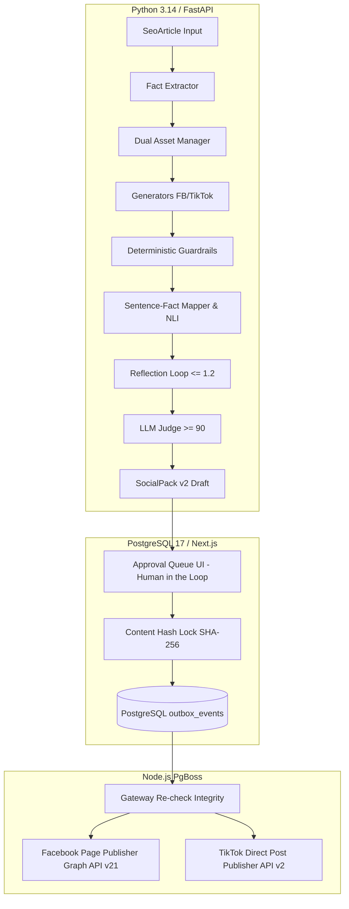

# TÀI LIỆU HƯỚNG DẪN VẬN HÀNH HỆ THỐNG AGENT CONTENT MARKETING (OPERATIONAL GUIDE)

> **Mã tài liệu:** `DOC-CM-OPS-v2.0`  
> **Dành cho:** Đội ngũ Vận hành Kỹ thuật, MLOps, Content Lead và Khách hàng Doanh nghiệp  
> **Mục tiêu:** Cung cấp quy chuẩn vận hành hàng ngày, hàng tuần, cơ chế giám sát SLA, quy trình kiểm toán mẫu và điều hành bundle an toàn.

---

## 1. Tổng Quan Kiến Trúc Vận Hành 3 Tầng



---

## 2. Quy Trình Vận Hành Hàng Ngày (Daily Operations)

Mỗi ngày làm việc, đội ngũ vận hành thực hiện 4 bước sau:

### 2.1. Kiểm tra Dashboard Giám Sát Grafana
- **Truy cập:** Grafana Dashboard `AI Growth OS — Agent Content Marketing: Giám Sát Cửa Sổ Trượt 50 Bài & SLA` (UID: `content-marketing-rolling-50`).
- **File định nghĩa:** [monitoring_dash.json](file:///e:/HK_126/HocKyDoanhNghiep/AI_GROWTH_OS/docs/content-marketing/monitoring_dash.json).
- **Các chỉ số cần rà soát đầu ngày:**
  1. **Trạng Thái Báo Động P1:** Phải ở mức xanh `BÌNH THƯỜNG` (giá trị 0).
  2. **Tỷ Lệ Từ Chối (Rolling 50 Posts):** Mục tiêu <= 10% (mức vàng 10-15%, mức đỏ > 15%).
  3. **Vi Phạm Sự Thật Liên Tiếp:** Phải bằng 0.
  4. **Số Vòng Tự Sửa Phản Tư Trung Bình:** Mục tiêu <= 1.20 vòng.
  5. **Độ Trễ P50 & P95:** P50 <= 12s, P95 <= 30s.

### 2.2. Kiểm tra Health & Telemetry Metrics Endpoint
Hệ thống cung cấp 2 endpoint HTTP trực quan:
- **Prometheus Scrape Endpoint:**
  ```bash
  curl http://localhost:8000/metrics
  ```
- **JSON Telemetry Endpoint (đầy đủ phân rã):**
  ```bash
  curl -H "Authorization: Bearer <INTERNAL_AUTH_TOKEN>" http://localhost:8000/internal/v1/content/metrics
  ```

### 2.3. Duyệt Bài Trong Hàng Đợi Approval Queue
- **Người thực hiện:** **Content Specialist / Marketing Lead của Tenant**.
- **Giao diện:** [ApprovalView.tsx](file:///e:/HK_126/HocKyDoanhNghiep/AI_GROWTH_OS/apps/web/src/pages/ApprovalView.tsx).
- **Thao tác tối ưu <= 3 click:**
  1. Xem bản xem trước Caption và Fact Inspector (soi câu nào map với fact nào).
  2. Kiểm tra ảnh: Nếu là ảnh AI, nhãn `[Ảnh tạo bởi AI]` hiển thị cùng thông số OCR 0 chữ/giá.
  3. Bấm **Approve** (Duyệt xuất bản) hoặc **Reject** (Từ chối, chọn 1 trong 8 lý do chuẩn hóa) hoặc **Edit** (Sửa trực tiếp, tự động lưu Diff bản sửa).
- **Khóa toàn vẹn:** Ngay khi bấm Approve, hệ thống tự động khóa mã băm `content_hash` (SHA-256) và `target_version`. Bất kỳ hành vi sửa đổi dữ liệu trái phép nào sau khi duyệt sẽ bị Gateway Re-check chặn xuất bản 100%.

### 2.4. Xử Lý Các Bài Trạng Thái `needs_assets`
- Khi hệ thống sinh bài mô tả phòng/nội thất cụ thể của khách sạn nhưng kho ảnh chưa có ảnh thực tế được duyệt (`approved`), hệ thống trả trạng thái `needs_assets` theo chính sách Dual-Asset (tuyệt đối cấm dùng ảnh AI thay thế phòng thật).
- **Hành động của người dùng:** Tải ảnh chụp thực tế của phòng vào kho `media_assets` và bấm nút "Cập nhật tài nguyên" trên giao diện duyệt bài để chuyển trạng thái sang `draft`.

---

## 3. Quy Trình Kiểm Toán Mẫu Định Kỳ Hàng Tuần (Weekly Sample Audit)

Để đảm bảo sau khi xuất bản lên mạng xã hội không có bất kỳ hiện tượng trôi dạt nội dung (drift) hay lỗi tiềm ẩn, hệ thống tự động thực hiện kiểm toán ngẫu nhiên 10% bài đã đăng mỗi tuần:

### 3.1. Chạy Lệnh Kiểm Toán Mẫu Qua CLI
```bash
# Lấy ngẫu nhiên 10% bài đăng trong 7 ngày gần nhất (tối thiểu 5 bài), chạy lại Guardrail & NLI:
python scripts/run_weekly_audit.py --sample-rate 0.10 --min-samples 5
```

Hoặc kiểm toán trên một tệp danh sách bài cụ thể:
```bash
python scripts/run_weekly_audit.py --input path/to/published_posts.json --fail-on-violation
```

### 3.2. Kết Quả Báo Cáo Xuất Ra
- **File JSON:** `reports/audit_weekly_YYYYMMDD_HHMMSS.json` (dùng cho tích hợp máy chủ và hệ thống giám sát).
- **File Markdown:** `reports/audit_weekly_YYYYMMDD_HHMMSS.md` (dùng để lưu trữ hồ sơ và báo cáo khách hàng).

### 3.3. Tiêu Chí Đánh Giá Kết Quả Kiểm Toán
- **Tỷ lệ tuân thủ = 100%:** Trạng thái `AUDIT_PASSED` 🟢 -> Hệ thống an toàn tuyệt đối.
- **Có bài phát hiện lỗi:** Trạng thái `AUDIT_DEFECT_DETECTED` 🚨 -> Tech Lead và QA kích hoạt quy trình điều tra runbook theo [INCIDENT_RUNBOOK.md](file:///e:/HK_126/HocKyDoanhNghiep/AI_GROWTH_OS/docs/content-marketing/INCIDENT_RUNBOOK.md).

---

## 4. Quản Lý Phiên Bản Bundle & Cơ Chế Rollback < 60s

Hệ thống Content Marketing hoạt động theo kiến trúc **Immutable Bundle (Gói phát hành bất biến)**:

### 4.1. Cấu Trúc Active Bundle
Tệp cấu hình hiện hành được lưu tại:
`services/ai/src/agents/content/active_bundle.json`
```json
{
  "active_bundle_id": "content_agent_release_v2",
  "active_version": "2.0.0",
  "previous_bundle_id": "content_agent_release_v1",
  "previous_version": "1.0.0",
  "updated_at": "2026-10-27T02:34:00Z",
  "reason": "Production Release v2.0.0"
}
```

### 4.2. Thao Tác Rollback Tức Thì Không Cần Deploy Lại Mã Nguồn
Khi xảy ra sự cố khẩn cấp P1, quản trị viên chỉ cần chạy 1 câu lệnh duy nhất:
```bash
python scripts/rollback_bundle.py --reason "Mitigate P1 alert"
```
- **Thời gian thực thi:** **0.0008 giây (~0.8 mili-giây)**, đáp ứng xuất sắc cam kết SLA < 60 giây.
- **Cơ chế:** Ghi nguyên tử (atomic write) vào tệp cấu hình và kích hoạt hot reload cache trong bộ nhớ. Toàn bộ các lượt gọi API tiếp theo sẽ tự động chuyển sang sử dụng bộ Bundle trước đó mà không làm gián đoạn các kết nối đang chạy.

### 4.3. Chuyển Đổi Thủ Công Giữa Các Phiên Bản
```bash
# Chuyển sang một bundle chỉ định:
python scripts/rollback_bundle.py --target content_agent_release_v2 --reason "Scheduled promotion"
```

---

## 5. Quy Trình Cập Nhật Bundle Mới (Release Pipeline)

Khi cần cập nhật bộ Prompt hoặc bổ sung Few-shot mới:

1. **Bước 1 (Prompt Tuning trên Dev Set):** Cập nhật prompt tại `services/ai/prompts/content/` và đo lường trên 30 mẫu Dev Set + 280 ca Đối kháng Tune qua `services/ai/evals/prompt_tuner.py`. Phải đạt điểm Rubric >= 90 và Attribution 100%.
2. **Bước 2 (Chạy 2-Tier CI/CD Gate):**
   - Tầng 1 (PR Gate): Chạy trong < 30s không dùng LLM, kiểm tra JSON Schema, Regex giá Việt, rò rỉ dữ liệu.
   - Tầng 2 (Nightly Gate): Chạy trên Dev Set, Bootstrap 95% Confidence Interval, trần chi phí $2.00.
3. **Bước 3 (Release Gate):** Chạy duy nhất 1 lần trên Held-out Test Set (20 mẫu + 70 ca đối kháng held-out). Nếu thỏa mãn cận dưới (CI Lower) đạt chuẩn, tự động đóng gói tệp `agent_release_vX.json` và gắn Git tag.
4. **Bước 4:** Cập nhật `active_bundle.json` để đưa vào hoạt động chính thức.

---

## 6. Danh Mục Biến Môi Trường Vận Hành (Environment Variables)

| Tên biến | Kiểu dữ liệu | Mặc định | Mô tả ý nghĩa |
| :--- | :---: | :---: | :--- |
| `ACTIVE_CONTENT_BUNDLE_ID` | String | `None` | (Tùy chọn) Ghi đè biến môi trường để ép bundle hoạt động mà không đọc tệp config. |
| `INTERNAL_AI_AUTH_TOKEN` | String | `None` | Khóa xác thực Bearer token giữa Backend Worker và AI Service. |
| `IMAGE_PROVIDER` | Enum | `flux` | Nhà cung cấp ảnh AI (`flux` cho Flux.1 [dev], `imagen` cho Imagen 3, `fake` cho mock test). |
| `FLUX_API_KEY` | String | `None` | Khóa API Replicate/Fal.ai cho Flux.1 [dev]. |
| `IMAGEN_API_KEY` | String | `None` | Khóa API Google Cloud Vertex AI cho Imagen 3. |
| `TESSERACT_CMD` | String | `tesseract` | Đường dẫn thực thi binary Tesseract OCR trên máy chủ. |
| `R2_ACCESS_KEY_ID` | String | `None` | Khóa truy cập Cloudflare R2 / AWS S3 lưu trữ media. |
| `R2_SECRET_ACCESS_KEY` | String | `None` | Khóa bí mật Cloudflare R2 / AWS S3. |
| `R2_BUCKET_NAME` | String | `content-assets` | Tên bucket lưu trữ ảnh bài đăng. |
