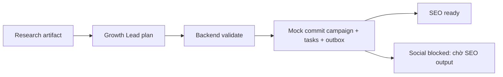

# QQ-04 — Growth Lead campaign/task plan

Ngày 15/10/2026. **Đã triển khai và local_verified với mock theo yêu cầu. Chờ Thiệu Quang + Thiệu review; chưa nghiệm thu tích hợp TQ-03.**

**Cập nhật 16/10 sau merge `my_be`:** đã có campaign/task/artifact/approval API, PostgreSQL migration 002, worker HTTP adapter và workflow runner. Đã sửa payload routing và kiểm tra Research → Growth Lead qua HTTP thật (fake model) → backend mock. Những ghi chú “chưa có” dưới đây là baseline 15/10; hiện còn thiếu **adapter PostgreSQL PlanRepository + plan submission route/outbox/dependency artifact wiring của QQ-04**. Các API chung đã có chưa tự thay thế adapter này. Full API tests/typecheck/build đã passed sau merge; standalone lint còn lỗi config có sẵn. Chi tiết [merge report](MERGE-MY-BE.md).

## Đã có

- Dedicated `opportunity.score`, `strategy.generate`, `brief.generate`: cùng một proposal contract/pipeline, prompt `growth-lead-v1`. `learning.analyze` không thuộc QQ-04, vẫn bootstrap.
- Chọn một finding từ research bằng model index; topic, audience/offer fit, URL/fetched_at/evidence lấy nguyên từ finding. Fake provider chọn finding đầu tiên; không giả số liệu demand hoặc tự tính hiệu quả campaign.
- Brief SEO có topic, informational intent, audience, offer, CTA, deliverable và acceptance. Brief social có cùng grounding, yêu cầu adapt output SEO và xác định ảnh thật hoặc báo thiếu ảnh. Đây là brief/task plan, chưa sinh bài/caption/ảnh (QQ-05).
- Hai task ID ổn định theo job/input_version. Social phụ thuộc SEO, pin research artifact ID/version/hash và khai báo task sẽ cung cấp artifact SEO.
- Validation AI trước run: tenant, profile version, snapshot pin, research hash, quote/source/version approved, human approval. Thiếu dữ liệu trả `blocked` + `missing_facts`.
- Backend TypeScript tải plan/research theo artifact ref từ repository; validate strict schema, role/tool allowlist, tenant/version/hash, current context/source approval, selected finding, brief, dependency graph và artifact handoff trước commit.
- Mock repository commit campaign/tasks/outbox đồng thời, retry dedup, conflict 409 khi cùng plan ID/version đổi nội dung. Chỉ SEO root vào outbox; social giữ `blocked`. Có failure injection và context recheck trước commit.



## Evidence đã chạy

- **120 test AI passed**, gồm 16 test mới QQ-04: ba operation, retry, restart, wrong workspace/profile/snapshot, artifact sửa, revoked source, approval, thiếu dữ liệu, context budget và model chọn index ngoài research.
- **21 test backend QQ-04 passed**: consume trực tiếp fixture Python, concurrent dedup, unknown role/tool, cycle/unknown dependency, duplicate task, wrong refs/version, missing CTA, fabricated opportunity, revoked source, commit failure, context race và conflict.
- TypeScript check riêng module/routes/demo/tests QQ-04: passed.
- [AI mock report](../../../qa/evidence/qq04/mock-report.json): research → plan qua HTTP ASGI TestClient, fake model, SQLite tạm; retry và reopen service đọc lại artifact.
- [Backend mock report](../../../qa/evidence/qq04/backend-mock-report.json): 201 lần đầu, 200 retry, một plan, SEO ready/outbox, social blocked. In-memory mock, chưa gửi queue.
- Full `npm.cmd test` ở API: 54 tests passed trong 4 file; suite cũ `tests/bootstrap.test.mjs` dùng Node test runner nên Vitest báo `No test suite found`, đồng thời các bootstrap checks cần API đang chạy. Chưa sửa ngoài phạm vi QQ-04.
- Full API `npm.cmd run typecheck` bị lỗi sẵn tại `.next/types/validator.ts:6` (`Cannot find module 'next/types.js'`). Module QQ-04 check riêng đạt; chưa coi full API build đạt.
- Warning FastAPI/Starlette TestClient về httpx deprecation còn có; không làm fail AI tests.

## Dữ liệu đã mock

| Thành phần | Mock hiện tại | Khi có thật |
| --- | --- | --- |
| Workspace/profile/goal/offer/audience | TripC MOCK, UUID cố định, version 1 | Backend cấp profile/goal đã được chủ nghiệp vụ xác nhận |
| Research source và approval | `example.org/qq04-mock`, đoạn văn tự tạo, approval TEST | Nguồn approved, quyền dùng nguồn, URL/fetched_at và version thật từ QQ-03 |
| CTA | `Request the newcomer guide (MOCK)` | CTA được Dương/người phụ trách business xác nhận |
| Model | fake provider; `synthetic=true` truyền tới plan/report | Chạy local Ollama thật, giữ provenance/synthetic đúng thực tế |
| Campaign/task/artifact lookup/outbox | `MockPlanRepository` trong bộ nhớ | Repository PostgreSQL + transaction/outbox của TQ-03/MY-01 |

Mock dữ liệu không biến thành production approved. Mặc định backend từ chối synthetic plan; chỉ demo/test bật cờ. Không có metrics, search volume, budget, thời hạn hay KPI bịa; phần này chưa được dùng để cam kết kết quả.

## Chưa có / nối sau

| Hạng mục | Hiện trạng / việc cần làm | Owner liên quan |
| --- | --- | --- |
| TQ-03 HTTP router + auth/RBAC | Có framework-agnostic `createCampaignPlanRoutes`; chưa mount Next.js route. Router phải xác thực membership/quyền tạo task và truyền **authorized workspace**, không lấy actor/scope từ body | Thiệu Quang |
| Database nghiệp vụ | Chưa có implementation `PlanRepository` PostgreSQL. `loadArtifact` phải trả artifact immutable đã lưu từ AI, `loadContext` trả snapshot/profile/source approval hiện hành | Thiệu Quang + Mỹ |
| Transaction/outbox thật | Implement `accept` khóa/recheck context, artifact version và source approval; unique workspace/plan_id/input_version; ghi campaign + tasks + outbox trong một transaction. Không enqueue trực tiếp trước commit | Thiệu Quang + Mỹ |
| Worker dispatch/resume | Chưa nối broker, lease/retry, dependency events. Consumer đọc outbox idempotent; social chỉ dispatch khi SEO output đúng workspace/version và đủ điều kiện review, resolve `dependency_artifact_from` sang ref thật | Mỹ |
| SEO/Content output | Brief đã có; dedicated SEO/Content handler, real image rights/assets và publish approval thuộc QQ-05/DU-04/MY-04 | Quang Quang + Dương + Mỹ |
| Live eval + review | Chưa chạy model live cho QQ-04, chưa có business data thật, chưa có Thiệu Quang/Thiệu approval | Quang Quang + reviewers |
| UI campaign/task | QQ-04 là AI/backend; chưa bổ sung dashboard, route frontend hoặc API client | Tiến / owner dashboard |

## Cách nối khi DB/API có

1. Worker lấy research AIResult đã persist, truyền `research` + `research_artifact` và profile/goal/snapshot cùng version vào `strategy.generate`. Dùng [request builder/mock input](../../../services/ai/examples/growth_lead_request.py) làm ví dụ cấu trúc; không reuse TEST approval.
2. Persist AIResult/result/evidence/artifact immutable trong backend repository. Request submit chỉ là `RunArtifact` ref, không gửi plan editable từ client.
3. Mount endpoint TQ-03 dự kiến `POST /v1/workspaces/{workspace_id}/campaign-plans` → `createCampaignPlanRoutes({repo: postgresRepo}).handleSubmit(authorizedWorkspaceId, body)`. **Đường dẫn này là mapping đề xuất, chưa tồn tại.** Response 201/200 có plan_id/task_states/outbox; lỗi dùng envelope HTTP chung.
4. Thay `MockPlanRepository` bằng PostgreSQL implementation, giữ nguyên service/validator. Không bật `allowSynthetic` trên production. Enqueue từ committed outbox; worker resolve dependency artifacts trước social.
5. Chạy lại 21 test contract, thêm integration tests DB rollback/concurrent/revocation, broker dedup/restart; chạy live model và reviewer eval trước nghiệm thu.

## Chạy lại

Từ repo root, Python đã có dependencies:

```powershell
python -m pytest services/ai/tests -q -p no:cacheprovider --basetemp D:/Hoc/qq04-pytest-new
python services/ai/scripts/smoke_qq04.py
python services/ai/scripts/export_qq04_contracts.py
cd apps/api
node_modules/.bin/vitest.cmd run tests/campaignPlans/submit.test.ts
node_modules/.bin/tsx.cmd scripts/demo-qq04.ts
node_modules/.bin/tsc.cmd --noEmit --strict --skipLibCheck --esModuleInterop --target es2022 --module esnext --moduleResolution bundler src/modules/campaignPlans/schemas.ts src/modules/campaignPlans/service.ts src/modules/campaignPlans/mockRepository.ts src/modules/campaignPlans/routes.ts tests/campaignPlans/submit.test.ts scripts/demo-qq04.ts
```

Mỗi lần pytest nên chọn `--basetemp` mới, tránh thư mục tạm cũ bị khóa trên Windows. Nếu `python` là Windows Store alias, dùng interpreter 3.14 tại đường dẫn trong [README Growth Lead](../../../services/ai/src/agents/growth_lead/README.md).
