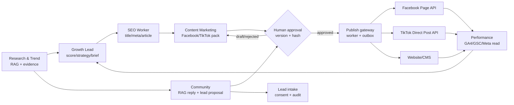

# MCP và connector cho 6 agent

Tài liệu này phân biệt **skill hướng dẫn** với **MCP/API connector chạy thật**. Skill không tự có OAuth token và không thể làm cho Facebook/TikTok đã kết nối nếu chưa cấp quyền tài khoản.

## Trạng thái cài đặt

- `tiktok-video-publishing` đã được tải từ `social-media-skills/skills` vào `C:\Users\ADMIN\.agents\skills\tiktok-video-publishing`.
- `social-publisher` đã được tải từ `claude-office-skills/skills` vào `C:\Users\ADMIN\.agents\skills\social-publisher`. Skill này khai báo `social-media-mcp`, nhưng npm registry không có package runtime `social-media-mcp`; không được coi là connector đã hoạt động.
- Runtime publish của dự án dùng adapter server-side trong `apps/worker/src/publish/`. Adapter không đưa token vào prompt, job payload hoặc audit log.

## Những connector 6 agent cần

| Nhóm | Agent dùng | Quyền tối thiểu | Trạng thái trong repo |
|---|---|---|---|
| Knowledge/RAG | Research, SEO, Content, Community, Growth Lead | read approved sources, tenant filter, evidence | Đã có pipeline/RAG và approval refs |
| GA4 + GSC | Performance, Growth Lead | read-only metrics/search analytics | Matrix + fail-closed `insufficient_data` |
| Facebook Page | Content, Community, Performance | `pages_read_engagement`, `pages_manage_posts` | Adapter Graph API + manual fallback |
| TikTok | Content, Community | `user.info.basic`, `video.publish` (photo scope nếu dùng ảnh) | Adapter Direct Post + opt-in flag |
| Approval/Outbox | cả 6 agent | read approval; publish cần version/hash/approval | Gateway + publishing jobs + outbox |
| Lead/Feedback | Community, Performance, Growth Lead | create proposal, human-approved intake | Lead service và audit |

## Cách nối tài khoản

1. Chạy migration `008_integration_connections.sql`.
2. Đăng ký ứng dụng Meta/TikTok, cấu hình callback HTTPS và OAuth scopes. Lưu access/refresh token trong vault hoặc secret manager; `integration_connections.credential_ref` chỉ lưu **tham chiếu**, không lưu token thô.
3. Cấu hình worker:

```text
INTEGRATION_MODE=production
FACEBOOK_PAGE_ID=...
FACEBOOK_PAGE_ACCESS_TOKEN=...
TIKTOK_ACCESS_TOKEN=...
TIKTOK_OPEN_ID=...
TIKTOK_DIRECT_POST_ENABLED=false   # chỉ bật sau khi app TikTok được review
```

### Đồng bộ analytics thật

Analytics không lấy dữ liệu từ tab Chrome. API dùng service account/token ở server và endpoint:

```text
POST /v1/workspaces/{workspace_id}/metrics/sync
```

Cấu hình thêm các biến server-only trước khi gọi endpoint:

```text
INTEGRATION_MODE=production
GA4_PROPERTY_ID=557397610
GSC_SITE_URL=https://example.com/
META_AD_ACCOUNT_ID=...
META_AD_CURRENCY=VND
```

Từng bước tạo service account và cấp quyền Search Console: [GSC-SETUP.md](GSC-SETUP.md).

`GOOGLE_SERVICE_ACCOUNT_JSON` được dùng cho GA4; `GSC_SERVICE_ACCOUNT_JSON` có thể dùng riêng cho Search Console. Endpoint gọi API provider, ghi daily snapshots vào `metrics_snapshots`, và chỉ đánh dấu provider `connected` sau khi request thành công. Nếu thiếu credential hoặc provider trả lỗi, response giữ nguyên lý do thiếu dữ liệu và không ghi số 0 giả.

4. Gọi `POST /v1/workspaces/{workspace_id}/integrations` để lưu metadata `status=connecting` (endpoint không nhận raw token). OAuth callback/probe nội bộ cập nhật connection thành `connected` kèm `verified_at`. API `GET /v1/workspaces/{workspace_id}/integrations` chỉ trả status/scopes, không trả secret.
5. Content tạo pack `draft` cho `facebook`/`tiktok`. Người dùng duyệt artifact. Khi schedule, API kiểm tra đúng `approval_id`, `version`, `content_hash`; worker kiểm tra lại gateway tại thời điểm publish.
6. Nếu provider chưa verified, job chuyển `manual`, sinh manual pack. Không có mock publisher trong `INTEGRATION_MODE=production`.

TikTok Direct Post yêu cầu URL media công khai đã được domain verify hoặc upload theo flow của TikTok. Nếu SocialPack chỉ có caption/ảnh chưa có media URL, worker trả `TIKTOK_MEDIA_REQUIRED` thay vì giả lập đăng bài.

## Luồng 6 agent



## Kiểm tra trước khi bật live

- `npm.cmd run check` trong `apps/api` và `apps/worker`.
- `npm.cmd test -- --run` trong `apps/api` và `apps/worker`.
- `python -m pytest -q` trong `services/ai`.
- Gọi integrations endpoint và xác nhận provider là `connected`, có `verified_at`, capability publish tương ứng là `connected`.
- Tạo một artifact có citation, approve, schedule Facebook/TikTok, kiểm tra outbox và publish status. Thu hồi approval hoặc sửa source phải làm gateway từ chối bằng `VERSION_MISMATCH`/`HASH_MISMATCH`.
